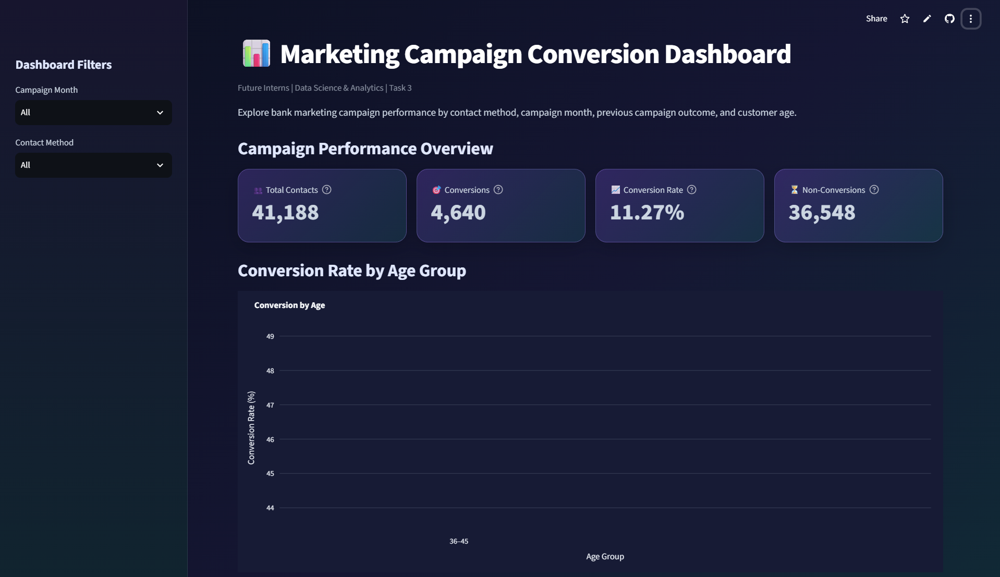
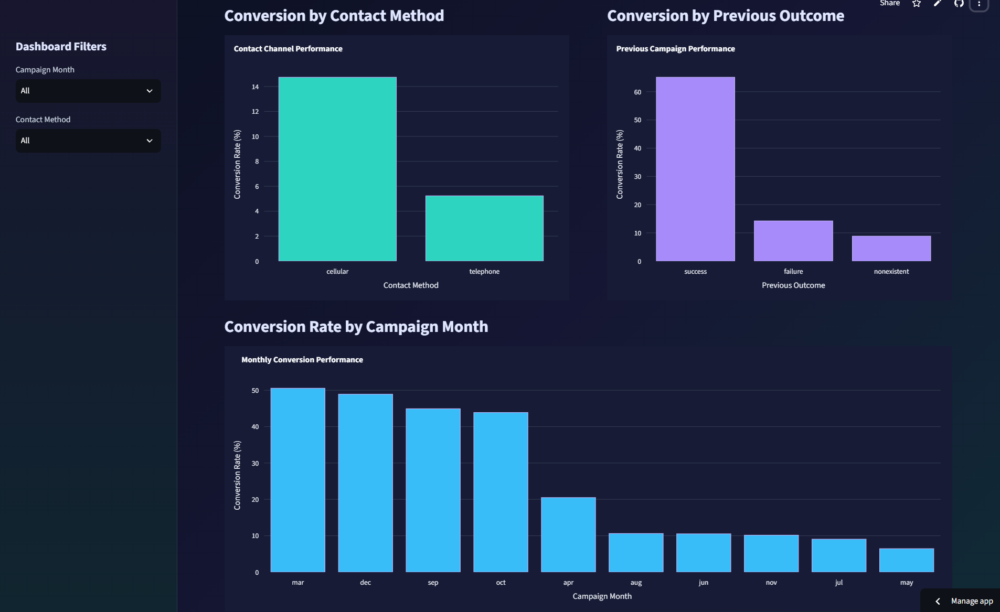
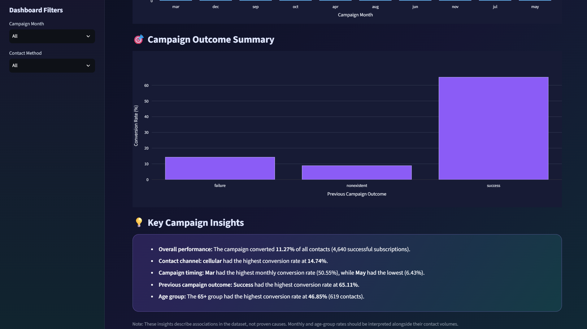

# 📊 Marketing Campaign Conversion Analysis

**Future Interns | Data Science & Analytics | Task 3**

An interactive data analytics project exploring bank marketing campaign performance and customer subscription patterns using Python and Streamlit.

## 🚀 Live Dashboard

[**View the Interactive Dashboard**](https://futureds-03.streamlit.app/)

## 📸 Dashboard Preview





## 🎯 Project Objectives

- Analyze the effectiveness of bank marketing campaigns.
- Evaluate conversion rates across contact methods and campaign months.
- Explore the relationship between previous campaign outcomes and subscription success.
- Compare customer conversion rates across age groups.
- Present key findings through an interactive dashboard.

## 🛠️ Tools & Technologies

- **Python** — data analysis
- **Pandas & NumPy** — data manipulation
- **Matplotlib, Seaborn & Plotly** — data visualization
- **Streamlit** — interactive dashboard development
- **Jupyter Notebook** — exploratory data analysis
- **Git & GitHub** — version control

## 📈 Key Findings

- **Total contacts:** 41,188
- **Successful subscriptions:** 4,640
- **Overall conversion rate:** 11.27%
- **Contact method:** Cellular contacts showed a higher conversion rate than telephone contacts.
- **Previous campaign outcome:** Customers with a previous successful campaign outcome had the highest conversion rate.
- **Campaign month:** Conversion rates varied considerably across months.
- **Age group:** Older customers showed relatively high conversion rates in the analysis.

*These findings describe patterns in the dataset and do not establish causation. Conversion rates should also be considered alongside the number of contacts in each group.*

## 📂 Project Files

- `app.py` — Streamlit dashboard application
- `task3_analysis.ipynb` — data analysis notebook
- `requirements.txt` — Python dependencies
- `bank-additional-full.csv` — dataset used by the application
- `Dashboard1.png` — dashboard screenshot

## ▶️ Run Locally

1. Clone this repository:

   ```bash
   git clone https://github.com/Ishita-0504/FUTURE_DS_03.git
   cd FUTURE_DS_03
   ```

2. Install dependencies:

   ```bash
   pip install -r requirements.txt
   ```

3. Run the dashboard:

   ```bash
   streamlit run app.py
   ```

## 👩‍💻 Author

**Ishita Das**

[GitHub Repository](https://github.com/Ishita-0504/FUTURE_DS_03) | [Live Dashboard](https://futureds-03.streamlit.app/)
ataset used for the analysis.
- `README.md` – Project documentation.
